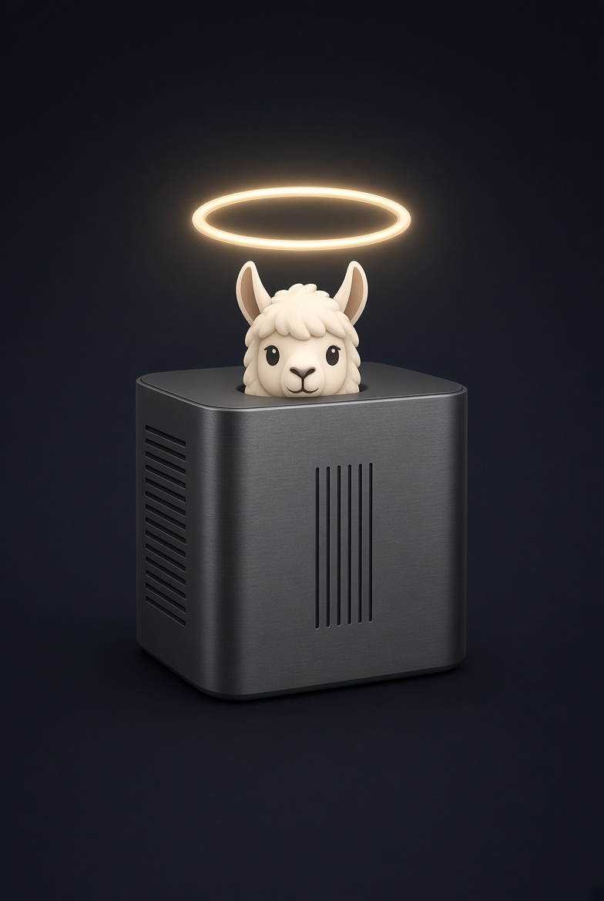
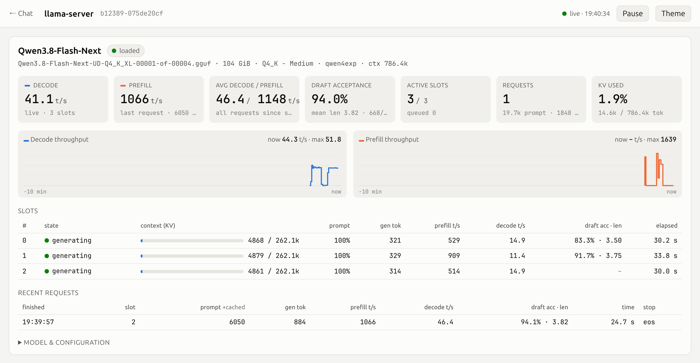
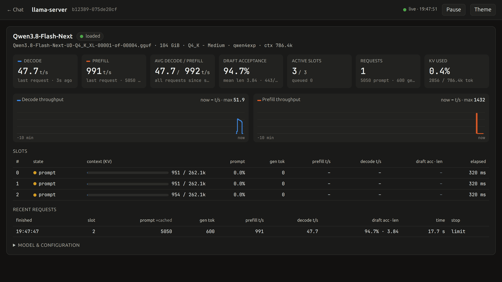
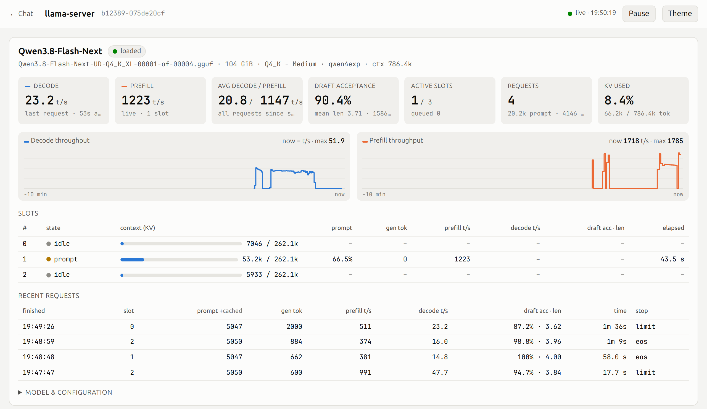
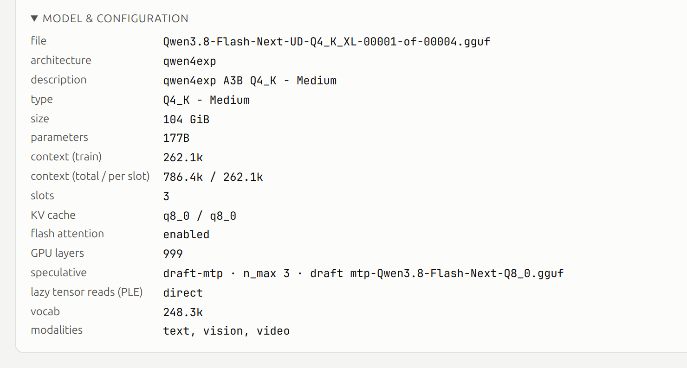

<p align="center"></p>

<h1 align="center">Qwen3.8-Flash-Next on AMD Strix Halo</h1>

This recipe serves Qwen3.8-Flash-Next (180B total, 6B active) from one 128 GB AMD Strix Halo through an
OpenAI-compatible API. Three requests run at once, each with the model's full 262,144-token context. It uses the
official [strix-llama.cpp](https://github.com/halo-box/strix-llama.cpp) images, so nothing is built on your machine.

## At a glance

| | Vulkan (default) | ROCm (`BACKEND=rocm`) |
| --- | ---: | ---: |
| Requests at once, each with a 262,144-token window | 3 | 1 |
| Decode, one request (prose / code) | 37.9 / 52.5 tok/s | 31.4 / 48.4 tok/s |
| Decode, three requests together (prose / code) | 50.1 / 50.5 tok/s | |
| Prefill, 32k / 128k-token prompt | 1,234 / 1,101 tok/s | 1,410 / 1,363 tok/s |
| GPU memory under full load | 102.0 GiB | 95.3 GiB |

The numbers come from [sparkDash](https://github.com/MiaAI-Lab/sparkDash), the benchmark that
[Mia's AI Lab](https://github.com/MiaAI-Lab) uses for its DGX Spark recipes, on a GMKtec EVO-X2 (Ryzen AI Max+ 395).
[Performance](#performance) has every table and the method.

<picture>
  <source media="(prefers-color-scheme: dark)" srcset="media/dashboard-dark.png">
  
</picture>

The server's own dashboard (`/dashboard`) at the defaults on Vulkan. Three code requests generate at once at 41.1
tok/s together. The request before them shows in the list: a 6,050-token prompt prefilled at 1,066 tok/s, then
decoded at 46.4 tok/s. The model accepted 94% of the MTP drafts.

## Quick start

You need a Strix Halo with 128 GB, Linux with Docker, and about 115 GB of free disk.

```bash
git clone https://github.com/halo-box/Qwen3.8-Flash-Next-Strix-Halo-llama.git
cd Qwen3.8-Flash-Next-Strix-Halo-llama
./setup.sh      # checks the host and offers to fix it; kernel parameter changes need a reboot
./start.sh      # BACKEND=rocm ./start.sh for ROCm
```

The first start downloads the model (about 109 GiB into `~/models/qwen38-flash-next`), checks each file against
Hugging Face's sha256, pulls the engine image and loads the model. A download that stops resumes where it left off.
When the smoke test passes, `start.sh` prints `Qwen3.8-Flash-Next is now LIVE on http://127.0.0.1:8080/v1`. Later
starts take about half a minute.

## Using the server

```bash
curl -s http://127.0.0.1:8080/v1/chat/completions -H 'Content-Type: application/json' -d '{
  "model": "Qwen3.8-Flash-Next",
  "messages": [{"role": "user", "content": "Write a Python fibonacci function."}],
  "max_tokens": 2000
}'
```

Any OpenAI client works with `base_url="http://127.0.0.1:8080/v1"` and the model `Qwen3.8-Flash-Next`. Streaming
and tool calls work. The model thinks before it answers and returns that text as `reasoning_content`, so give replies
enough `max_tokens`, or send `"chat_template_kwargs": {"enable_thinking": false}`. The server samples with the
model's own defaults (temperature 1.0, top-p 0.95, top-k 20). Values in a request override them.

```bash
./start.sh restart                       # after changing a setting; a bad setting leaves the running server alone
./start.sh --print                       # print the docker command and exit
./stop.sh                                # stop the server and free the GPU memory
docker logs -f qwen38-flash-next-strix   # server log
```

### Images

The model's own vision tower is on by default. `VISION=0` turns it off. Send images as OpenAI content parts:

```bash
IMG=$(base64 -w0 photo.jpg)
curl -s http://127.0.0.1:8080/v1/chat/completions -H 'Content-Type: application/json' -d '{
  "model": "Qwen3.8-Flash-Next",
  "messages": [{"role": "user", "content": [
    {"type": "image_url", "image_url": {"url": "data:image/jpeg;base64,'"$IMG"'"}},
    {"type": "text", "text": "What is in this picture?"}]}],
  "max_tokens": 2000
}'
```

### Serving other machines

The server listens on `127.0.0.1:8080`, so only the machine itself can reach it. To serve other machines, set an API
key and the address to listen on, then restart:

```bash
API_KEY=$(openssl rand -hex 24) HOST=0.0.0.0 ./start.sh restart     # or put both in .env
```

Docker publishes the port with its own firewall rules, which come before ufw (Ubuntu) and firewalld (Fedora). A ufw
or firewalld rule therefore neither opens nor closes the port. To limit who can connect, set `HOST` to one of the
machine's addresses, or add a rule to Docker's `DOCKER-USER` chain. This one allows only the local network:

```bash
sudo iptables -I DOCKER-USER -p tcp --dport 8080 ! -s 192.168.0.0/16 -j DROP
```

### Dashboard and metrics

`http://<host>:8080/dashboard` is the server's own dashboard. It shows decode and prefill speed live and over the
last ten minutes, MTP draft acceptance, each request's progress and KV use, the last requests and the configuration.
It asks for the API key when one is set. `http://<host>:8080/metrics` serves the same counters to Prometheus.

Three code requests arriving at once, 20 seconds. The prompts prefill at up to 1,743 tok/s, then all three generate:

<p align="center"></p>

A long prompt half way through its prefill, at 1,238 tok/s. The bar shows 49.2k of the request's 262.1k window:

<picture>
  <source media="(prefers-color-scheme: dark)" srcset="media/long-prompt-dark.png">
  
</picture>

The configuration the server reports, which is the recipe's: three 262.1k windows, a q8_0 KV cache, MTP with three
drafts, and the n-gram table read from disk:

<picture>
  <source media="(prefers-color-scheme: dark)" srcset="media/configuration-dark.png">
  
</picture>

## Performance

These are the defaults: 3 × 262,144-token windows on Vulkan and 1 on ROCm. The machine is a GMKtec EVO-X2 (Ryzen AI
Max+ 395, 128 GB) on Ubuntu 26.04 with kernel 7.0.0-43, 107 GiB of GTT, `amd_iommu=off` and the tuned
`accelerator-performance` profile. sparkDash ran on the same machine, with the same settings as Mia's
Qwen3.8-Flash-Next recipes, so the numbers compare with theirs:

- Prose runs at temperature 0.7 with thinking on. Code runs at temperature 0 with thinking off, and each stream gets
  a different Python task.
- Each stream generates 400 tokens. Every decode run repeats three times, and the tables show the median.
- Per request is the mean of each stream's `(completion_tokens - 1) / (time of the last token - time of the first)`.
  Time to first token is not part of it.
- Aggregate counts every stream's decode tokens over the window from the first stream's first token to the last
  stream's last token. It is not the sum of the per-request speeds.
- TTFT is the mean time to the first token, measured by the client.
- Prefill sends a cold prompt with a unique prefix each run. Its speed is llama-server's own prompt timing, and the
  token count includes the chat template.

MTP drafts only pay off when the model accepts them, so decode speed depends on the text. A number from another
benchmark compares only with the same prompts, sampling and thinking setting. A single prose run varies by 10 to 25%,
which is why each run repeats. `bench/sparkdash.py` runs the benchmark (see [Benchmarks](#benchmarks)).

### Vulkan (default, 3 × 262k, q8_0 KV cache)

#### Decode, prose

| Concurrent requests | Aggregate | Per request | TTFT |
| ---: | ---: | ---: | ---: |
| 1 | 37.9 tok/s | 37.9 tok/s | 98 ms |
| 2 | 49.5 tok/s | 25.2 tok/s | 423 ms |
| 3 | 50.1 tok/s | 16.8 tok/s | 467 ms |

#### Decode, code

| Concurrent requests | Aggregate | Per request | TTFT |
| ---: | ---: | ---: | ---: |
| 1 | 52.5 tok/s | 52.5 tok/s | 315 ms |
| 2 | 64.2 tok/s | 33.0 tok/s | 420 ms |
| 3 | 50.5 tok/s | 17.0 tok/s | 507 ms |

#### Prefill, cold prompts

| Prompt tokens | Prefill | TTFT |
| ---: | ---: | ---: |
| 4,134 | 1,200 tok/s | 3.45 s |
| 8,231 | 1,209 tok/s | 6.82 s |
| 16,423 | 1,224 tok/s | 13.44 s |
| 32,806 | 1,234 tok/s | 26.62 s |
| 65,575 | 1,184 tok/s | 55.41 s |
| 131,111 | 1,101 tok/s | 119.15 s |

### ROCm (1 × 262k, f16 KV cache)

#### Decode, prose

| Concurrent requests | Aggregate | Per request | TTFT |
| ---: | ---: | ---: | ---: |
| 1 | 31.4 tok/s | 31.4 tok/s | 98 ms |

#### Decode, code

| Concurrent requests | Aggregate | Per request | TTFT |
| ---: | ---: | ---: | ---: |
| 1 | 48.4 tok/s | 48.4 tok/s | 353 ms |

#### Prefill, cold prompts

| Prompt tokens | Prefill | TTFT |
| ---: | ---: | ---: |
| 4,136 | 1,358 tok/s | 3.06 s |
| 8,225 | 1,410 tok/s | 5.84 s |
| 16,424 | 1,421 tok/s | 11.57 s |
| 32,807 | 1,410 tok/s | 23.28 s |
| 65,572 | 1,393 tok/s | 47.13 s |
| 131,111 | 1,363 tok/s | 96.26 s |

## Memory

GTT is the part of the machine's RAM that the kernel lets the GPU use. `bench/memory.sh` and runs under load
measured these (UD-Q4_K_XL, MTP and vision on, the 28 GB n-gram table read from disk, ubatch 4096):

| Backend, KV cache | Requests × window | GTT once loaded | GTT peak under full load |
| --- | --- | ---: | ---: |
| Vulkan, q8_0 | 3 × 262,144 (default) | 97.4 GiB | 102.0 GiB |
| Vulkan, q8_0 | 4 × 196,608 | 98.2 GiB | |
| Vulkan, q8_0 | 4 × 212,992 | 99.3 GiB | over 102.5 GiB, stopped |
| ROCm, f16 | 1 × 262,144 (default) | 93.5 GiB | 95.3 GiB |

The model takes 79.4 GiB on the GPU. Each 262,144-token window adds 4.3 GiB with a q8_0 KV cache or 7.8 GiB with f16.
The compute buffers take 7 to 10 GiB, whatever the number of requests. Vulkan fills its memory pages as prompts grow,
so its peak is about 4.6 GiB above what it holds once loaded. The memory plan in `start.sh` uses the peak
(`MODEL_GIB`, `COMPUTE_GIB`, `KV_GIB_PER_262K`).

ROCm keeps an f16 cache because its attention kernels for this model accept only f16 keys and values. With q8_0, it
falls back to a slower path whose buffers grow by about 14 GiB per 262k window.

`start.sh` refuses a configuration that needs more than the smallest of three limits:

- the GTT limit minus 2 GiB
- `MemTotal` minus 10 GiB (Mia's DGX Spark recipe keeps 9 GiB free)
- `MemTotal` minus `CmaFree` minus 6 GiB

The last limit matters on kernels that type free RAM as CMA without reserving a CMA area. This machine shows 7 to 14
GiB of it (`nr_free_cma` and `/proc/pagetypeinfo` count it, while the boot log says `0K cma-reserved` and `CmaTotal`
is 0). GPU pages cannot use CMA blocks. With 12 GiB of them, a server here died at 99 GiB of GTT, well under its 104
GiB limit. `./setup.sh` warns when it finds CMA-free memory. Shorter windows fit more requests: set
`CONTEXT_PER_SLOT`, or `auto` for the largest window that fits.

## Configuration

Settings live in [`scripts/config.sh`](scripts/config.sh). Override them in the environment (`PARALLEL=2 ./start.sh`)
or in a `.env` file next to `start.sh`. `start.sh` reads `.env` as `KEY=value` lines and never runs it. Arguments
after `--` go to `llama-server` last (`./start.sh restart -- --verbose`), and `start.sh` passes on every `LLAMA_ARG_*`
variable.

| Variable | Default | Meaning |
| --- | --- | --- |
| `BACKEND` | `vulkan` | `vulkan` or `rocm`. The image, KV cache type and number of requests follow it |
| `IMAGE` | per backend | the engine image |
| `SERVER_BIN` | none | the path of `llama-server` in an `IMAGE` whose entrypoint is something else |
| `MODEL_DIR` | `~/models/qwen38-flash-next` | where the model files are, or where they download to |
| `HOST` / `PORT` / `API_KEY` | `127.0.0.1` / `8080` / none | set `API_KEY` before `HOST=0.0.0.0` |
| `PARALLEL` | `3` (Vulkan), `1` (ROCm) | requests served at once, each with its own window; `auto` serves as many as fit |
| `CONTEXT_PER_SLOT` | `262144` | tokens each request may use, prompt and reply; `auto` picks the largest window that fits `PARALLEL` requests |
| `KV_DTYPE` | `q8_0` (Vulkan), `f16` (ROCm) | KV cache type |
| `UBATCH` | `4096` | prompt batch size |
| `MTP` / `MTP_DRAFT_N` | `1` / `3` | MTP speculative decoding and its draft length |
| `SPEC_DRAFT_MAX_SLOTS` | `2` | draft only while at most this many requests generate; 0 drafts always |
| `VISION` | `1` | image input |
| `TEMPERATURE` / `TOP_P` / `TOP_K` / `MIN_P` | `1.0` / `0.95` / `20` / `0` | default sampling, the model's own |
| `CTX_CHECKPOINTS` / `CACHE_RAM` | `4` / `0` | per-request state checkpoints and the host prompt cache; both grow host RAM over time |

### What `start.sh` does

1. `scripts/prepare.sh` downloads any missing model file and pulls the engine image.
2. The memory plan works out what the configuration takes on the GPU and refuses one that does not fit. The error
   says how many requests would fit.
3. `start.sh` checks the arguments with `llama-server` in a throwaway container, so a typo leaves a running server
   alone. It refuses to start while another `llama-server` runs.
4. While the model loads, `start.sh` shows the memory loaded so far. It kills the server at once if GTT passes the
   budget or the host's usable memory drops under 4 GiB.
5. One chat completion runs as a smoke test, then the LIVE message appears.

`FOREGROUND=1 ./start.sh` stays attached to the server's log and exits with its exit code, for a systemd unit.

## How the defaults were chosen

Each row comes from a sparkDash run on this machine, with one request, a 262,144-token window and MTP on, unless the
row says otherwise.

| Choice | Measured | Kept |
| --- | --- | --- |
| ubatch 4096 | ROCm, Signal, one request: 1,077 / 1,080 tok/s prefill at 8k / 32k, against 1,032 / 1,014 with 2048. A 262k window costs nothing against 40k (1,078 / 1,081) | 4096, as in the release recipe |
| Q4_K weights, not ROCmFP4 | ROCm, q8_0 KV, 40k window, ubatch 4096: UD-Q4_K_XL prefills 1,241 / 925 tok/s at 8k / 32k against 893 / 714 for Agention's ROCmFP4, and decodes 31.5 / 50.4 (prose / code) against 35.2 / 55.8 | Q4_K_XL, because on long prompts the faster prefill finishes a request first |
| UD-Q4_K_XL, not AgentionAI's Signal AP-Q4_K_XL | ROCm, 40k, ubatch 4096, f16 KV: UD-Q4_K_XL prefills 1,433 / 1,424 tok/s at 8k / 32k, Signal 1,078 / 1,081. Signal takes 9 GiB less on the GPU (70.1 against 79.4), enough for 4 × 262k. It was the default until this run | UD-Q4_K_XL |
| f16 KV on ROCm | ROCmFP4, ROCm: f16 decodes 42.4 / 55.1 tok/s and prefills 894 tok/s at 32k in 82.0 GiB. q8_0 decodes 32.8 / 53.6, prefills 653 tok/s at 32k and takes 99.2 GiB | f16 on ROCm |
| q8_0 KV on Vulkan | with #271, the compute buffers stay at 6.8 to 8.5 GiB from one to four windows (Signal), so each 262k window costs 4.3 GiB against 7.8 with f16 | q8_0 on Vulkan |
| Vulkan as the default | only Vulkan fits 3 × 262k (ROCm fits 1). At the defaults Vulkan decodes 37.9 / 52.5 tok/s and prefills 1,234 tok/s at 32k, ROCm 31.4 / 48.4 and 1,410 | Vulkan |
| 3 MTP drafts, not 4 | ROCm, Signal, two runs each: 36.1 / 53.9 tok/s with 3 drafts, 29.9 / 55.4 with 4 | 3 |
| unsloth's Q8_0 MTP head | the release recipe's head. It decodes as fast as Agention's ROCmFP4 head (33.5 / 52.4 against 32.8 / 53.6 tok/s) | unsloth Q8_0 |
| No retained-PM4 ROCm runtime | kyuz0's PM4 build of the same commit (ROCm 10.0) against the official image (ROCm 10.1), one run each: decode up 9% / 8%, prefill down 2 to 3% | not used. It was one run and needs a second image |
| No flash-attention mask patch | earlier versions patched a GPU fault on a ~241k prompt whose last chunk is a partial tile. This build serves a 262,131-token prompt (a partial last tile) on ROCm and Vulkan without it | not carried |
| Draft only while at most 2 requests generate | Vulkan, Signal, 4 × 262k, aggregate tok/s at 1 / 2 / 4 requests. Prose: 36.1 / 44.0 / 46.6 drafting always, 34.9 / 46.0 / 61.5 with `--spec-draft-max-slots 2`. Code: 53.9 / 48.0 / 65.8 and 57.0 / 48.7 / 62.2. With 1, code at two requests fell to 28.3 | 2 |
| `--no-spec-draft-backend-sampling` | AgentionAI's model cards: drafting on the backend skips min-p for accepted drafts, and a repetition can run away when a client sends min-p | on |

## Checks

All of these pass on the machine above at the defaults, with the pinned images:

| Check | Vulkan, 3 × 262k | ROCm, 1 × 262k |
| --- | --- | --- |
| `tests/check.py`: chat, streaming, a required tool call, image input | ok | ok |
| A prompt of exactly 262,144 tokens gets HTTP 400 | ok | ok |
| `--window`: 262,131 prompt + 13 reply tokens fill the window, and the last prompt chunk is a partial tile | served in 272 s | served in 202 s |
| `--long`: every request at about 196k tokens (3/4 of its window) at once | 3 × 196k in 555 s | 1 × 196k in 146 s |
| GTT peak and lowest usable RAM (`MemAvailable - CmaFree`) under that load | 102.0 / 8.6 GiB | 95.3 / 18.4 GiB |
| amdgpu or OOM errors in the kernel log | none | none |

```bash
python3 tests/check.py              # chat, streaming, tool call, image, a prompt the size of the window refused
python3 tests/check.py --window     # also a request that fills the window exactly
python3 tests/check.py --long 3     # also 3 requests at once, each with 3/4 of a window
tests/host_test.sh                  # GPU detection against fake KFD topologies, no GPU needed
tests/bootloader_test.sh            # setup.sh's kernel parameter step on each boot loader, in containers
```

### Tested hardware

| Host | Distro, kernel | GTT | Result |
| --- | --- | --- | --- |
| GMKtec EVO-X2 (Ryzen AI Max+ 395, 128 GB) | Ubuntu 26.04, 7.0.0-43 | 107 GiB | every check above. A fresh clone runs the quick start as written |

Some parts are tested without the hardware. `tests/host_test.sh` finds the gfx1151 among other GPUs through KFD's
topology. `tests/bootloader_test.sh` runs the kernel parameter step on rpm-ostree, kernelstub, grubby, Debian and
Arch GRUB, extlinux and systemd-boot. `./setup.sh --check` runs in Ubuntu 26.04, Debian 13, Fedora 44, Arch and
Alpine 3 containers.

Other vendors' Strix Halo machines, other distros and kernels on real hardware, and a second GPU in the same machine
are not tested yet. The memory plan reads each host's own GTT limit, `MemTotal` and `CmaFree`, so a host with more
usable memory gets a larger budget. To add a host, open an issue with the output of `./setup.sh --check`,
`./start.sh` and `python3 tests/check.py --window`.

## Requirements

- Any Strix Halo (Ryzen AI Max, gfx1151) with 128 GB, from any vendor. A second GPU, such as an eGPU or a discrete
  card, can stay in. The recipe finds the gfx1151 through KFD and gives the container only its render node.
- The BIOS UMA or dedicated graphics memory set to its minimum. The GPU uses GTT, and a carve-out takes memory from
  it.
- GTT raised to `MemTotal` minus 10 GiB (`ttm.pages_limit`, `amdgpu.gttsize`) and `amd_iommu=off`. `./setup.sh`
  works out the values from your RAM and asks before it adds them. It knows rpm-ostree (Bazzite, Silverblue),
  kernelstub (Pop!_OS), grubby (Fedora), GRUB (Debian, Ubuntu, Arch), extlinux (Alpine) and systemd-boot. For other
  boot loaders, add the parameters by hand.
- Linux with the amdgpu driver. Kernel 7.0 (Ubuntu 26.04) is tested; older kernels are not.
- Docker, with your user in the `docker` group, and `bash`, `curl`, `python3`, `sha256sum` and `pgrep` on the host.
  On Alpine: `apk add bash curl python3 docker`.
- About 115 GB of free disk for the model files, plus the engine image: 0.3 GiB (Vulkan) or 8.6 GiB (ROCm).

## Benchmarks

```bash
python3 bench/sparkdash.py --label vulkan --clients 1,2,3   # against the running server
bench/sweep.sh bench/plans/readme.txt                       # restart with each configuration, then measure
bench/memory.sh bench/plans/memory.txt                      # what each configuration takes on the GPU
```

`bench/sparkdash.py` starts sparkDash (`sparkdash:da20ac5`) in a container on the host network, registers this
machine as a local unit and runs the benchmarks through sparkDash's API. Build the image once with
`docker build -t sparkdash:da20ac5 https://github.com/MiaAI-Lab/sparkDash.git#da20ac5b4940bd9ff349fdb020e32252dd71fa21`.
Results go to `results/sparkdash/<label>.md` and `.json`.

## Notes

- Never load with `--load-mode mmap` on this hardware. On Vulkan, a later load in the same boot fails with
  `Couldn't update BO_VA (-12)` in `dmesg`, and the GPU driver can hang until a reboot. On ROCm, KFD refuses it. The
  recipe reads the weights with `--load-mode none` and the n-gram table row by row (`--lazy-mode on-direct`).
- After many hours of GPU work in the same boot, a load this size can fail with `Couldn't update BO_VA (-12)`. It can
  also leave the server stuck in the kernel (process state `D`, GTT still held). The driver cannot get the small
  unmovable allocations it needs for page tables. A reboot fixes it, so load the model early in a boot.
- Do not start a configuration past the memory plan (`FORCE=1`) on Vulkan. Vulkan fills GTT pages as it first
  touches them, after any allocation check. Near the GTT limit, the kernel then kills host services before anything
  can stop it. ROCm refuses an allocation that does not fit.

## Repository layout

| Path | Contents |
| --- | --- |
| `setup.sh` | host checks and fixes: GPU, BIOS carve-out, host tools, Docker, kernel, GTT parameters, tuned |
| `start.sh` / `stop.sh` | serve and stop |
| `scripts/config.sh` | every setting, with `.env` and environment overrides |
| `scripts/prepare.sh` | model download and sha256 check, image pull |
| `scripts/host.sh` | finds the gfx1151 (render node, GTT counters) through KFD's topology |
| `tests/check.py` | checks against the running server |
| `tests/host_test.sh` | `scripts/host.sh` against fake topologies, no GPU needed |
| `tests/bootloader_test.sh` | `setup.sh`'s kernel parameter step on each boot loader, in throwaway containers |
| `bench/sparkdash.py`, `bench/sweep.sh`, `bench/memory.sh`, `bench/plans/` | speed and memory measurements |

## Credits

[CREDITS.md](CREDITS.md) lists where each file, setting and idea came from. The engine and its images come from
[halo-box/strix-llama.cpp](https://github.com/halo-box/strix-llama.cpp), built on
[llama.cpp](https://github.com/ggml-org/llama.cpp). The model is Qwen's, quantized by [Unsloth](https://unsloth.ai).
The benchmark is [sparkDash](https://github.com/MiaAI-Lab/sparkDash). Host setup follows
[claudejaune/Qwen3.8-Halogen-Flash-Strix-Halo](https://github.com/claudejaune/Qwen3.8-Halogen-Flash-Strix-Halo), and
the shape of this repository follows [Mia's AI Lab](https://github.com/MiaAI-Lab).
